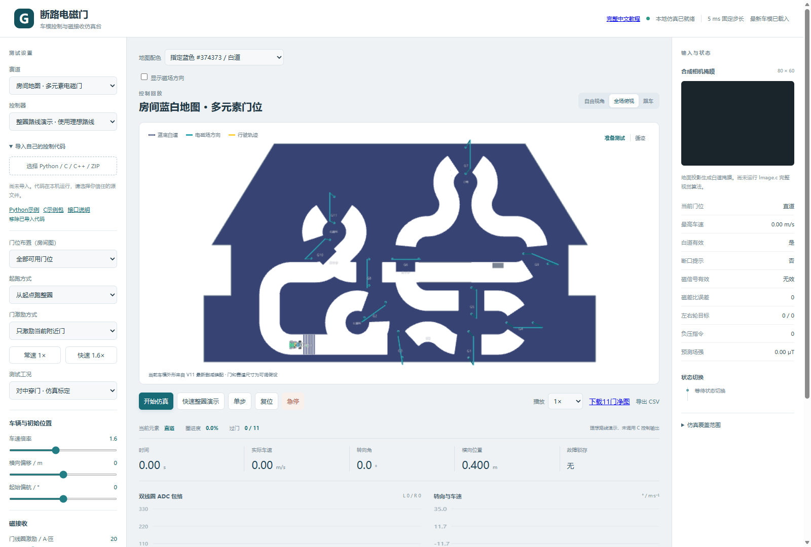

# GateCar Simulator

蓝底白道的智能车控制仿真台，包含30.331 m房间赛道、11处可切换电磁门、V11车模、双线圈磁信号和CSV日志。

**可以导入自己的Python或C/C++控制代码。** 用户控制器读取传感器输入，在5 ms固定步长下输出车速、转向和负压指令。默认整圈演示使用理想路线，便于查看地图；测试代码时请选择“用户导入代码”。

**第一次使用请读：[完整中文使用教程](docs/中文使用教程.md)。** 解压后也可直接双击根目录的`使用教程.html`，离线查看20章教程、操作截图、接口单位、Keil算法适配和报错排查。



## 下载与启动

在 [Releases](https://github.com/qq735/gatecar-simulator/releases) 下载ZIP并解压。也可点击仓库的 **Code → Download ZIP**。

### Windows

1. 安装64位Python 3.10或更新版本，建议3.12，安装时勾选Add Python to PATH。
2. 解压后双击 **Start.cmd**。
3. 首次缺少依赖时，启动器会创建`.venv`并安装numpy、scipy、shapely，需要联网。后续运行使用本机依赖，前端不依赖在线CDN。
4. 浏览器自动打开本地页面，通常为`http://127.0.0.1:8870`。端口占用时自动尝试后续端口，以终端打印地址为准。

查看地图、理想路线演示和导入Python代码均不需要C编译器。**导入C/C++及使用内置参考C核心，需要GCC或Clang。** Windows可安装MSYS2，在UCRT64环境执行`pacman -S mingw-w64-ucrt-x86_64-gcc`，将其`ucrt64/bin`加入PATH。也可通过环境变量`CC`指定编译器可执行文件。

### Linux / macOS

```sh
python3 -m venv .venv
# Linux/macOS:
. .venv/bin/activate
python -m pip install -r requirements.txt
python start.py
```

Linux的C/C++控制器需要gcc/g++，macOS需要Clang命令行工具。程序已提供相应编译路径，当前本机验证平台为Windows，其他平台由仓库CI覆盖后再确认结果。

## 导入自己的代码

1. 在左侧“导入自己的控制代码”下载 **Python示例** 或 **C示例包**。
2. 修改示例控制逻辑，保留接口函数。
3. 选择`.py`、`.c`、`.cpp`或源码`.zip`文件，界面显示导入文件和SHA256。
4. 导入成功后自动切换“用户导入代码”，点击“开始代码测试”。
5. 查看实际轨迹、磁信号、相机掩膜、故障提示，或导出CSV。

Python入口：

```python
def reset(config):
    return {}

def step(sensors, state):
    return {
        'speed_m_s': 0.7,
        'steer_deg': 1.7 * sensors['visual_error_deg'],
        'fan': 0.35,
        'enabled': bool(sensors['line_valid']),
    }
```

C/C++入口是`gatecar_reset()`和`gatecar_step()`，结构体及声明见[sdk/gatecar_api.h](sdk/gatecar_api.h)。多文件ZIP需要唯一的`controller.py`、`controller.c`或`controller.cpp`入口。其他源码与头文件可放在子目录。

**完整Keil/STM32/STC工程不能直接当作PC程序运行。** 将控制与图像算法提取到适配器，在PC端用传感器输入代替MCU寄存器、定时器和外设驱动。详细单位、接口和迁移步骤见[代码接入说明](docs/CODE_IMPORT.md)。示例仅提供基础循迹起点，未实现圆环、十字或磁引导。

代码在下载者的电脑上执行。独立进程用于限制卡死、异常和C崩溃影响，不是安全沙箱；只导入自己编写或信任的代码。

## 赛道和工况

- 11处门位：直道、左右圆环、S弯、回头弯、原直道、正十字出口、Ω弯、坡道出口、路障接近段、斜十字接近段。
- 可全部放门，也可选择单门并从门前1 m开始测试。
- 默认断口沿中心线长0.60 m，门宽0.60 m、高0.50 m，均为训练假设。
- 默认背景蓝色`#374373`、白色道路，支持黑白线图切换。
- 可调ADC噪声、接收延迟、相机中断、弱磁和急停等工况。
- 可显示磁场方向、切换俯视/跟车/自由视角，并下载道路净图。

房间总进深约4.987 m由用户手绘推算，右下短边暂按0.62 m对称。图纸不能代替现场尺寸复测。

## 四种控制方式

| 模式 | 输入与用途 |
|---|---|
| 用户导入代码 | 双线圈ADC、编码器、陀螺仪、延迟后的相机掩膜和简化视觉误差，输出由用户代码决定 |
| 内置参考C核心 | 编译包内`control_src`，测试已有状态机和保护逻辑 |
| 整圈路线演示 | 使用已知赛道路线，便于展示地图与车模，不能证明用户代码完成全圈 |
| 传感器参考 / 手动 | 简单对照或手动观察 |

用户接口不提供车辆真实X/Y、赛道进度、理想目标点或由场景标注的元素类别。用户可以使用80×60相机掩膜自行实现视觉处理，也可先用简化误差调试。

## 仿真覆盖范围

车辆采用平面自行车模型，包含舵机和电机一阶延迟。磁场采用矩形线圈分段Biot–Savart计算，接收侧是线圈轴投影、增益、噪声、延迟和ADC包络模型。

没有实测轮胎附着、悬架和气动负压模型，没有模拟实际LC谐振Q值、检波器响应、金属涡流或电调EMC。坡道主要显示升降与俯仰，路障未接入专门避障算法。内置参考C模式尚未运行完整`Image.c`等视觉补线链。

默认理想路线演示的峰值速度约2.16 m/s，整圈约20.335仿真秒，11门均经过。该结果仅适用于当前模型，不代表实车高速检测距离或用户代码成绩。用户代码模式保持真实的`counts_per_m`编码器映射；内置旧C模式保留历史倍率映射，比较标定时应使用1倍速度。

## 测试和发布

```sh
python -m unittest discover -s tests -v
python test_multigate.py
```

第一条覆盖Python、C/C++、多文件ZIP、接口单位、异常/卡死、错误导入保留和HTTP会话隔离。第二条运行地图、11门、速度档位、固定步长和内置C故障回归。

浏览器验证需先启动服务，然后安装`requirements-dev.txt`并执行`python browser_multigate_qa.py`。浏览器可通过环境变量`GATECAR_BROWSER`指定Edge/Chrome可执行文件。

```sh
python tools/package_release.py
```

发布ZIP只含运行源码、SDK、示例、地图、GLB、前端库及说明。`.venv`、`build`、导入项目、日志、绝对本机路径和编译库不进入发布包。

来源和许可证见[NOTICE.md](NOTICE.md)。
