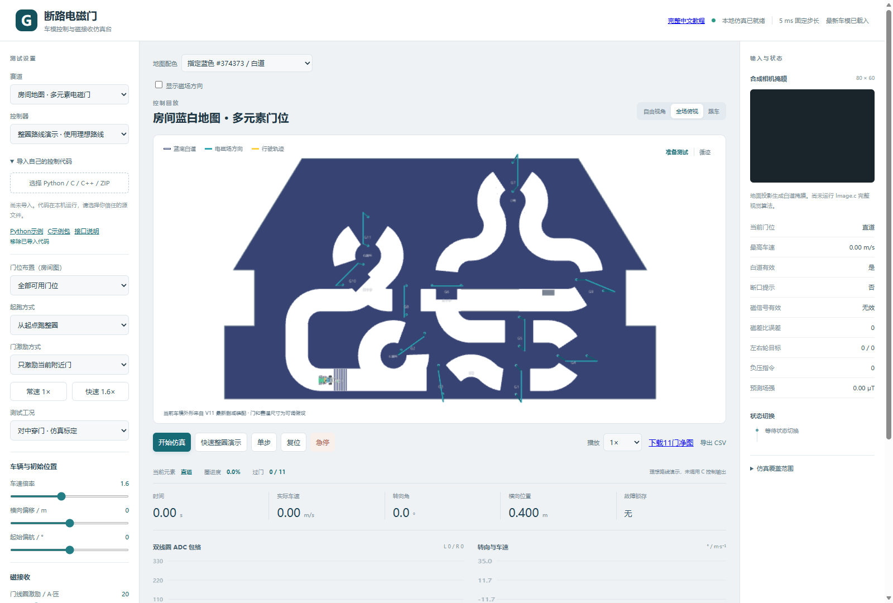

# GateCar Simulator 完整中文使用教程

版本：1.0.0　更新：2026年11月15日

适用对象：第一次使用仿真的同学，以及准备接入Python、C/C++或现有智能车控制算法的开发者。

## 1. 先了解这个软件做什么

这是在电脑上运行的智能车控制仿真台。它把赛道、车模、相机掩膜、编码器和双线圈磁信号交给控制程序，再根据程序输出推动车辆。

你可以：

- 查看房间蓝白地图和11处电磁门，切换到圆环、Ω弯、十字附近的单门。
- 导入自己的控制代码，看车辆如何转向、加减速、过门和停车。
- 观察ADC信号、相机掩膜、转向、速度与状态变化。
- 制造弱磁、噪声、延迟、相机中断和急停工况。
- 导出CSV，把现象对应到每一个5 ms控制周期。

本软件不连接实车、不烧录单片机。理想路线演示能跑完，不代表你导入的代码也能跑完。实际比赛规则、门线圈频率与高速接收能力仍需用正式资料和实物确认。

## 2. 下载哪个文件

仓库地址：<https://github.com/qq735/gatecar-simulator>

建议进入Releases，下载`gatecar-simulator.zip`。没有Release时，可以使用仓库页面的“Code → Download ZIP”。两种方式都要先解压，不能在压缩包窗口内直接双击启动器。

建议解压到普通目录，例如：

```text
D:\SmartCar\gatecar-simulator
```

文件夹中应该能看到：

```text
gatecar-simulator/
  Start.cmd                 Windows启动入口
  start.py                  自动检查依赖并启动服务
  start.sh                  Linux/macOS启动入口
  requirements.txt          运行依赖
  README.md                 简要说明
  simulation.py             车辆、传感器与仿真循环
  server.py                 本地网页服务
  sdk/gatecar_api.h          C/C++接口定义
  examples/controller.py    Python接入示例
  examples/controller.c     C接入示例
  control_src/              内置参考C控制核心
  web/                     网页、Three.js与车模
  docs/                    教程、接入说明和预览
  tests/                   自动测试
  tools/                   打包工具
```

`build/`和`.venv/`是运行时产生的目录，首次解压没有它们是正常的。你不需要原作者电脑上的CAD文件、Keil工程或旧仿真文件夹。

## 3. 需要安装什么

| 你想做的事 | 必需软件 |
|---|---|
| 看地图、运行理想路线演示 | 64位Python 3.10以上、Edge/Chrome等支持WebGL的浏览器 |
| 导入Python控制器 | 同上 |
| 导入C/C++控制器 | 同上，另装GCC/Clang；C++还需要g++/clang++ |
| 运行内置参考C核心 | GCC或Clang |
| 使用Git克隆仓库 | Git，可选，直接下载ZIP不需要 |
| 修改Keil工程中的算法 | 提取为PC可编译算法，仿真本身不需要Keil或SolidWorks |

推荐Python 3.12的64位版本。Windows本机已经在Python 3.14下验证。需要安装numpy、scipy、shapely，启动器可在缺少依赖时自动安装。

### 3.1 Windows安装Python

从Python官方入口下载安装：<https://www.python.org/downloads/>

安装时勾选“Add Python to PATH”。安装后重新打开终端，运行：

```powershell
python --version
```

如果系统使用Python Launcher，也可以运行：

```powershell
py -3 --version
```

显示3.10或更新版本即可。启动器优先使用`py -3`，没有Launcher时使用`python`。

### 3.2 Windows安装C/C++编译器

只使用Python代码的同学可以跳过。

安装MSYS2：<https://www.msys2.org/>

在MSYS2 UCRT64终端中安装GCC工具链：

```sh
pacman -S mingw-w64-ucrt-x86_64-gcc
```

把MSYS2安装目录下的`ucrt64\bin`加入PATH。例如默认安装位置对应：

```text
C:\msys64\ucrt64\bin
```

重新打开终端验证：

```powershell
gcc --version
g++ --version
```

若不想修改PATH，也可在准备启动程序的同一个PowerShell窗口中临时设置：

```powershell
$env:CC = 'C:\msys64\ucrt64\bin\gcc.exe'
python start.py
```

C++项目还需要编译器目录中存在`g++.exe`。仿真只使用GCC/Clang编译本机DLL/SO，不会使用Keil的C51/C251编译器。

## 4. 第一次启动

### 4.1 Windows双击启动

1. 打开解压后的目录。
2. 双击`Start.cmd`。
3. 如果缺少依赖，等待启动器创建`.venv`并下载依赖。第一次需要联网，完成后前端地图和车模均从本机载入。
4. 终端出现`SIMULATOR_READY http://127.0.0.1:8870`后，浏览器自动打开。
5. 页面显示蓝底白道和车模，表示启动成功。

运行过程中保留终端窗口。关闭它或按Ctrl+C后，本地服务停止，网页也就无法继续推进仿真。

端口8870占用时，程序自动尝试后续9个端口。以终端打印的实际地址为准，不必一直刷新旧地址。

### 4.2 手动安装依赖和启动

在项目目录的终端运行：

```powershell
python -m venv .venv
.\.venv\Scripts\python.exe -m pip install -r requirements.txt
.\.venv\Scripts\python.exe start.py
```

上述写法不要求激活环境，也不需要修改PowerShell执行策略。

指定端口或者不自动打开浏览器：

```powershell
python start.py --port 8890 --no-browser
```

### 4.3 Linux或macOS

```sh
python3 -m venv .venv
. .venv/bin/activate
python -m pip install -r requirements.txt
python start.py
```

需要C/C++时，Linux安装gcc/g++，macOS安装Clang命令行工具。当前发布前的实机检查在Windows完成，其他平台请同时参考GitHub Actions测试状态。

### 4.4 这不是GitHub Pages

GitHub只存放源码和下载包。代码编译与运行发生在下载者自己的电脑上，需要本地Python服务。不能直接把`web/index.html`拖进浏览器当作完整程序运行，也不能只下载`web`文件夹。

## 5. 界面怎么读



左侧是赛道、控制器、门位、起跑方式、代码导入和参数。中间是三维场景、运行按钮、车辆状态和曲线。右侧是相机掩膜、当前门位和事件记录。

| 按钮或项目 | 作用 |
|---|---|
| 开始仿真 / 暂停 / 继续 | 连续运行或暂停 |
| 快速整圈演示 | 切换到已知理想路线控制，便于看地图，不测试用户代码 |
| 单步 | 每次推进5 ms |
| 复位 / 应用参数并复位 | 时间归零、车辆回到起跑处、清空当前轨迹，并调用控制器reset |
| 急停 | 当前测试输出动力归零，进入故障状态，需要复位 |
| 俯视 / 跟车 / 自由视角 | 切换观察方式 |
| 显示磁场方向 | 显示解析模型的磁场方向箭头 |
| 地图配色 | 在指定蓝底白道与黑白线图间切换 |
| 导出CSV | 下载当前浏览器标签页的运行日志 |

当前界面在较窄窗口会隐藏右侧栏，建议电脑全屏使用。

## 6. 四类控制器不要混淆

### 6.1 整圈路线演示

使用赛道理想路线控制转向，适合查看全部元素、门位和车模动画。默认采用此模式，所以没有C编译器也能开始体验。

### 6.2 用户导入代码

车辆由你导入的Python或C/C++代码控制。接口不给理想路线、真实X/Y或场景元素标签。你可以自行使用相机掩膜识别赛道元素，也可先使用简化视觉误差调试控制器。

### 6.3 内置参考C核心

编译包内`control_src/CarCore.c`和`CarProfiles.c`，主要用于观察既有状态机、PID和故障保护。此模式不自动读取电脑上的其他智能车工程。它目前没有接入完整`Image.c`等视觉补线链，在圆环或Ω弯可能失败，不能把理想演示结果当作该核心的测试结果。

### 6.4 传感器参考与手动控制

传感器参考控制器用于简单对照。手动控制使用界面的手动车速、转向角，适合检查方向和观察局部姿态。

## 7. 第一次先跑通演示

1. 赛道选“房间地图”。
2. 控制器保持“整圈路线演示”。
3. 门位选“全部可用门位”。
4. 起跑方式选“从起点跑整圈”。
5. 车速倍率1.6，播放1倍。
6. 点击开始仿真，或者快速整圈演示。
7. 观察圈进度、过门计数和事件记录，结束后显示完成闭环。

默认条件下，理想路线演示约20.335仿真秒完成一圈、峰值约2.16 m/s，经过11门。终端运算、浏览器帧率和网络请求可能使墙上时间更长，这不改变固定5 ms仿真步长。

## 8. 导入Python代码的完整步骤

### 8.1 获取并修改示例

左侧点击“Python示例”，或复制项目里的`examples/controller.py`到自己的工作目录。不要直接编辑网页JS代替控制代码。

最小可运行接口：

```python
def reset(config):
    return {'last_error': 0.0}

def step(sensors, state):
    error = sensors['visual_error_deg']
    state['last_error'] = error
    enabled = bool(sensors['line_valid']) and not sensors['kill']
    return {
        'speed_m_s': 0.7,
        'steer_deg': max(-30, min(30, 1.7 * error)),
        'fan': 0.35,
        'enabled': enabled,
        'fault': 0 if enabled else 3,
    }
```

`reset`在每次复位时执行，返回的字典会持续传给后续`step`。`step`每5 ms执行一次，不要自己写一个永远不返回的主循环，也不要在里面长时间sleep。

### 8.2 从文件导入

1. 先选“独立电磁门与断口”，或房间地图中选择“无门”，便于先测循迹。
2. 点击“选择Python / C / C++ / ZIP”，选择修改后的`.py`。
3. 导入成功后，界面显示文件名、语言和SHA256，并自动选择“用户导入代码”。
4. 点击“开始代码测试”。
5. 观察转向是否正确、车速是否合理、白道丢失后是否停车。

修改文件后需要重新导入。仿真运行的是导入时的代码快照，不会自动监听原文件变化。

### 8.3 使用自己的视觉算法

`sensors['camera_gray']`为长度4800的一维数组，宽80、高60。访问第r行、第c列：

```python
value = sensors['camera_gray'][r * 80 + c]
```

白道约240，背景约24。`frame_new`为1时才有新图像，避免同一旧帧被重复当成多次识别证据。模拟相机通常20 ms产生一帧，控制仍然每5 ms运行。

`visual_error_deg`、`line_valid`和`gap_hint`是内置简化算法给出的结果；若你要验证自己的元素识别，应从图像自行计算这些信息，不能把内置提示当成算法测试结果。

### 8.4 多文件Python项目

压缩包示例：

```text
my-controller.zip
  controller.py
  vision.py
  pid.py
```

必须有唯一的`controller.py`入口。入口同目录可以`import vision`、`import pid`。需要额外第三方库时，先安装到运行仿真的同一个Python环境。

## 9. 导入C或C++代码

### 9.1 单文件C示例

左侧下载“C示例包”，得到`controller.c`和`gatecar_api.h`。保留接口函数：

```c
#include "gatecar_api.h"

void gatecar_reset(void) {
    /* 初始化PID、滤波器和状态机 */
}

void gatecar_step(const GateCarInput *in, GateCarOutput *out) {
    out->enabled = in->line_valid && !in->kill;
    out->speed_m_s = 0.7;
    out->steer_deg = 1.7 * in->visual_error_deg;
    out->fan = 0.35;
}
```

每次调用前宿主把输出结构体清零，必须显式设置`enabled`才能启动车辆。不要修改结构体字段顺序或类型。宿主会检查API版本和结构体大小。

可以直接选单个`.c`，仿真会自动提供头文件并编译。编译失败会显示编译器错误，原来已导入的控制器继续保留。

### 9.2 多文件C/C++项目

```text
my-controller.zip
  controller.c
  control/pid.c
  control/pid.h
  vision/vision.c
  vision/vision.h
```

入口应唯一，命名为`controller.c`或`controller.cpp`。源码支持子目录，程序把源码目录加入头文件搜索路径。C++使用相同SDK，头文件已经处理`extern "C"`。

不要把编译得到的DLL、EXE、Keil LIB或MCU目标文件放进ZIP。`abi.c`由仿真自动提供，不要重复上传。当前上限为压缩文件2 MB、展开8 MB、100个文件、30个C/C++源文件。

## 10. 现有Keil/STM32/STC工程如何适配

完整嵌入式工程通常包含寄存器、DMA、ISR、串口和专用编译器语法，电脑不能直接运行这些内容。推荐保留算法，替换外设边界：

| 原工程调用 | 仿真替代输入/输出 |
|---|---|
| ADC读取磁信号 | `adc_l`、`adc_r` |
| 编码器读取与清零 | `wheel_l`、`wheel_r`，每5 ms计数 |
| 陀螺仪Z轴 | `gyro_z_deg_s` |
| 相机DMA完成标记 | `frame_new` |
| 相机缓冲区 | `camera_gray` |
| 舵机PWM | `steer_deg`，单位度 |
| 电机PWM | `use_pwm=1`，写`left_pwm/right_pwm` |
| 两路涵道油门 | `fan`需求，用于记录和显示 |
| 定时器5 ms回调 | 每次`gatecar_step`调用 |

建议先建立一个`controller.c`适配器，调用已有PID和状态机。把主程序里的无限循环、硬件初始化和中断屏蔽移出PC构建。STC专用`data`、`xdata`等关键字需要通过条件编译处理，预编译Keil库需要源代码的PC版本。

原算法分辨率不等于80×60时，应适配尺寸和透视标定。仿真不会自动证明原程序的相机DMA、中断优先级、MCU运行时或实车线束正确。

## 11. 输入和输出单位

### 11.1 传感器输入

| 字段 | 单位与说明 |
|---|---|
| dt_s | 0.005秒 |
| time_s | 累计仿真秒 |
| adc_l / adc_r | 0..4095，低频包络值，不是150 kHz载波波形 |
| wheel_l / wheel_r | 本周期编码器计数 |
| counts_per_m | 每米编码器计数 |
| gyro_z_deg_s | 度/秒，符号沿用原适配层，与车辆逆时针yaw rate相反 |
| visual_error_deg | 正左负右，简化前瞻误差，±30°范围 |
| frame_new | 1表示新相机帧到达 |
| camera_gray | 80×60灰度掩膜，按行排列 |
| arm / kill | 启动首周期 / 急停输入 |

速度估计可以用：

```text
左轮速度 m/s = wheel_l / (counts_per_m × dt_s)
右轮速度 m/s = wheel_r / (counts_per_m × dt_s)
```

用户模式不会通过车速倍率偷偷修改编码器标定。要让自己的控制器采用`speed_scale`，需要在代码中明确使用它。

### 11.2 控制输出

| 字段 | 单位与范围 |
|---|---|
| speed_m_s | 米/秒，默认转成两轮相同开环PWM需求 |
| steer_deg | 正左负右，宿主限幅±35° |
| fan | 0..1，映射为500..1000的电调需求，不计算真实吸地力 |
| enabled | 必须显式为true/1才能输出动力 |
| use_pwm | 为true时改用直接PWM，忽略speed_m_s |
| left_pwm / right_pwm | -10000..10000，有符号电机PWM |
| gate_state | 0循迹、1准备、2磁引导、3重捕获、4离门确认 |
| fault | 0正常，1未就绪，2相机超时，3丢线，4磁失效，5门区限制，6急停 |

`speed_m_s`并不是已经实现的轮速闭环。如果需要测试自己的轮速PID，应使用编码器反馈和`use_pwm`直接输出PWM。

宿主在急停和非零fault时归零动力。车辆仍会受电机模型惯性影响，不能把这个过程理解为真实主动刹车验证。

## 12. 怎样测试电磁门

### 12.1 单门起步

1. 门位选择“左圆环内”或其他单门。
2. 起跑方式选择“从选中门前1米起跑”。
3. 保持较低速度和默认噪声。
4. 选择用户代码或内置参考C核心。
5. 看断口前是否有有效磁信号，过门时有没有碰框，出口是否重新捕获白道。
6. 通过后再增加横向偏移、起始偏航和接收延迟。

这11处门位覆盖直道、左/右圆环、S弯、回头弯、原直道、正十字出口、Ω弯、坡道出口、路障接近段、斜十字接近段。十字门位放在接近/出口位置，避免直接挡住其他分支。

### 12.2 全部门位

“全部可用门位”同时显示11个门，默认只激励当前附近门。当前门切换由场景理想进度调度，不是已经实现的赛事门控协议。

如果改为“全部门同时激励”，接收值包含多个解析磁场叠加，可以观察邻门干扰。幅值过大可能饱和，不能简单认为越强越可靠。

### 12.3 通过计数代表什么

“过门11/11”是车辆外包络穿过门平面的几何计数。它不单独证明代码已经完成磁引导与白道重捕获，应结合用户报告的gate_state、相机有效性及轨迹判断。

## 13. 参数怎么调

| 参数 | 作用和注意点 |
|---|---|
| 车速倍率 | 理想路线演示用于提高目标速度；用户代码是否采用由自己决定 |
| 播放倍率 | 只改变仿真时间推进速度，不是车辆速度参数 |
| 起始横向偏移、偏航 | 模拟车辆进入门区时不对中 |
| 门线圈激励A·匝 | 改变解析场强度，不能直接当成实物线圈电流 |
| 接收增益 | 改变感应幅值到ADC的比例，过大会饱和 |
| 有效幅值和门限 | 两路扣除零点后的有效信号门限 |
| ADC噪声 | 给接收包络叠加随机扰动，随机种子固定时可复现 |
| 接收延迟 | 模拟磁数据到达延迟 |
| 相机延迟 | 推迟图像和简化视觉结果到达 |
| 断口长度 | 沿路线删除白道，圆环处跟随曲线 |
| 门宽、门高 | 用于显示和简化碰框检查 |
| 线圈前探、高度、轴角 | 改变接收采样位置与方向，GLB杆件外形不会重新建模 |
| counts_per_m | 编码器标定，用户程序单位换算要一致 |
| 舵机单位/度 | 内部指令映射，用户直接填写角度即可 |

改完参数点击“应用参数并复位”。单次只改变一项，再比较轨迹和日志，较容易判断原因。

## 14. 相机掩膜怎么看

右侧80×60图像由地面道路区域投影得到。它是合成掩膜，没有真实镜头畸变、曝光变化和原始彩色图像。

断口会造成白道缺失，十字会出现多个分支，圆环会产生连续曲率。你可以用它测试边线提取、补线、状态机和控制交接，但最终仍需使用真实DCXG200图像重新标定。

新帧未到达时保持旧图。用户代码可以自行累计图像超时，不要把同一帧在多个5 ms周期内重复识别当成多帧确认。

## 15. CSV日志怎么分析

点击“导出CSV”，使用Excel或Python打开。CSV用UTF-8编码，包含每个仿真周期的记录。

| 字段 | 分析用途 |
|---|---|
| t、speed、steer_deg | 看何时加速、转向和停止 |
| adc_l、adc_r | 看幅值、左右差和饱和 |
| bx_uT、by_uT、bz_uT | 解析模型预测场，不是实测数据 |
| line_valid、gap_hint | 对照白道丢失和重捕获 |
| gate、fault、enabled | 看状态变化及撤动力时刻 |
| left_pwm、right_pwm | 检查轮速控制和差速输出 |
| x、y、course_progress | 只在日志里辅助诊断，不作为用户控制器输入 |

Python读取示例：

```python
import csv
with open('simulation_log.csv', encoding='utf-8-sig', newline='') as f:
    rows = list(csv.DictReader(f))
for row in rows:
    if int(row['fault']):
        print('首次故障', row['t'], row['fault'])
        break
```

复位会清空当前运行日志。需要比较两次测试时，先导出第一份再复位。不同浏览器标签页的仿真、导入代码和日志相互独立。

## 16. 报错与恢复

| 现象 | 检查方法 |
|---|---|
| 双击启动后提示找不到Python | 安装Python并勾选PATH，重新开终端验证python或py -3 |
| 缺少numpy/scipy/shapely | 用当前解释器执行python -m pip install -r requirements.txt |
| pip下载失败 | 检查网络，保留报错，在网络恢复后重新执行安装；不要下载随机DLL替代依赖 |
| 找不到C编译器 | 验证gcc --version，检查PATH或CC；只用Python可以先跳过 |
| 找不到g++ | 安装完整GCC工具链，C++需要g++或clang++ |
| 浏览器连接失败 | 确认终端未关闭，查看实际端口，避免使用file://打开页面 |
| 车模载入失败 | 完整解压，确认web/assets/vehicle.glb存在，不要只复制HTML |
| 页面能打开但无三维画面 | 使用支持WebGL的Edge/Chrome，查看页面错误，检查浏览器图形支持 |
| Python导入提示没有step | 添加step(sensors, state)函数，返回字典 |
| ZIP提示多个入口 | 只保留一个controller.py/controller.c/controller.cpp入口 |
| C编译undefined reference | 将所需.c/.cpp源码一起打包，检查函数声明、定义与C/C++链接 |
| 用户代码错误/响应超时 | step不得无限循环或长时间sleep；修复后重新导入 |
| 代码已导入但车不动 | 检查enabled、fault、速度值以及代码是否丢线后主动停车 |
| 转向方向相反 | steer_deg正左负右，检查算法符号和gyro约定 |
| 点了快速整圈演示后成绩很好 | 该按钮切到了理想路线；重新选用户导入代码再测试 |
| 刷新后代码不见了 | 每个页面创建新会话，需要重新导入，原代码文件不丢失 |
| 增大速度倍率但用户车速没变 | 用户代码需自行采用speed_scale，或直接修改speed_m_s/PWM |
| 圆环或Ω弯测试失败 | 示例没有完整元素识别，按轨迹、图像与状态逐项调试，不是软件承诺自动完赛 |

代码崩溃/超时后，原工作进程会停止，需要修复并重新导入，不能只点复位期待错误程序恢复。正常暂停可以继续，故障或急停需要复位。

## 17. 推荐调试流程

1. 理想演示：确认软件、地图和车模能正常显示。
2. 无门低速直道：确认自己的输出单位、方向和enabled逻辑。
3. 小偏移白道：确认循迹和转向闭环。
4. 独立直道门：实现弱磁、丢线和出口确认。
5. 圆环/Ω弯单门：测试视觉与电磁交接，避免只依赖幅值峰值。
6. 噪声/延迟/断帧：确认失效后停止及状态不误跳。
7. 全地图：逐元素调整前瞻、轮速、舵角和负压需求。
8. 实车：重新核对接线、标定、真实图像、电流、温升和有效检测距离。

## 18. 自测与二次开发

在项目根目录执行：

```sh
python -m unittest discover -s tests -v
python test_multigate.py
```

第一条测试代码导入、Python/C等价接口、多文件ZIP、异常、超时、C崩溃和会话隔离。第二条运行地图、单门、11门整圈、速度与内置C保护回归。

浏览器检查：

```sh
python -m pip install -r requirements-dev.txt
python server.py --no-browser
# 另开终端，在同一目录执行：
python browser_multigate_qa.py
```

浏览器验证默认查找Edge/Chrome，可用`GATECAR_BROWSER`指定路径。临时截图和日志进入`build/`，不进入Git仓库。

## 19. 文件维护与更新

- 自己编写的源文件请另存到自己的代码目录，再导入仿真。
- `build/user_projects/`是导入快照和编译产物，不应作为唯一源码备份。
- `build/`可以在停止服务后清理，重新启动会重建。
- `.venv/`可以在停止服务后删除，下次缺少依赖会重新安装。
- 更新版本时解压到新目录，保留自己的控制源码和CSV日志，再重新导入。
- 本地运行记录、用户导入代码和缓存默认不上传GitHub。

## 20. 仿真结果的边界

已实现的是固定步长软件在环测试。它不包含真实LC谐振Q值、接收电路频响、放大器饱和恢复、检波延迟、金属涡流、电调EMC、真实轮胎附着和气动负压。

门碰撞使用400×190 mm平面车身包络，没有对前探杆和每个CAD实体做精确动力学碰撞。坡道只显示高度和俯仰，路障没有专门避障动力学。

只导入自己编写或信任的代码。独立工作进程用于隔离崩溃和卡死，不是安全沙箱；代码仍有当前用户的本机程序权限。默认服务只监听本机，不要作为公网代码执行网站部署。

遇到问题时，记录软件版本、操作步骤、导入语言、配置、错误文字和CSV中的首次异常时刻，便于复现。
